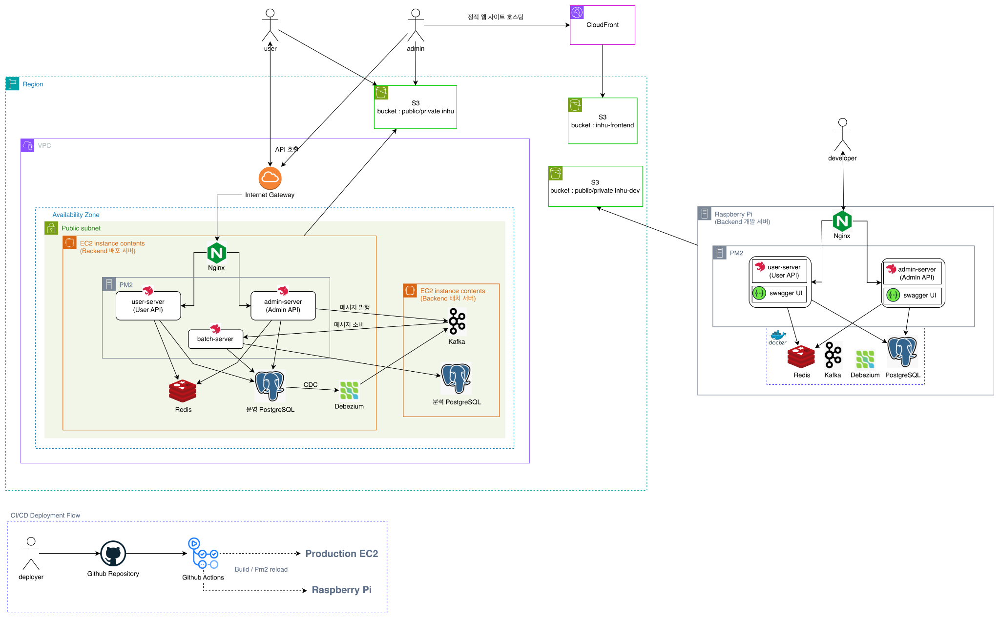

# 인하밥길

인하대학교 학생들을 위한 후문 상권 맛집 정보 서비스입니다.

- Web Link: [inhu.co.kr](https://inhu.co.kr)
- App Store: [인하밥길](https://apps.apple.com/kr/app/%EC%9D%B8%ED%95%98%EB%B0%A5%EA%B8%B8-%EC%9D%B8%ED%95%98%EB%8C%80-%EC%A3%BC%EB%B3%80-%EB%A7%9B%EC%A7%91-%EC%B9%B4%ED%8E%98-%EC%88%A0%EC%A7%91%EC%9D%84-%ED%95%9C%EB%88%88%EC%97%90/id6751269937)
- Play 스토어: [인하밥길](https://play.google.com/store/apps/details?id=com.inhu.inhu)
- 운영 기간: 2024.12 ~ 현재

## Architecture



## Applications

| 애플리케이션   | 역할                           |
| -------------- | ------------------------------ |
| `user-server`  | 사용자용 API                   |
| `admin-server` | 관리자용 API                   |
| `batch-server` | 배치 작업 및 Kafka 이벤트 처리 |

## Local Development

```bash
npm install
npm run dev-infra:up
npm run prisma:generate
npm run start:dev
```
